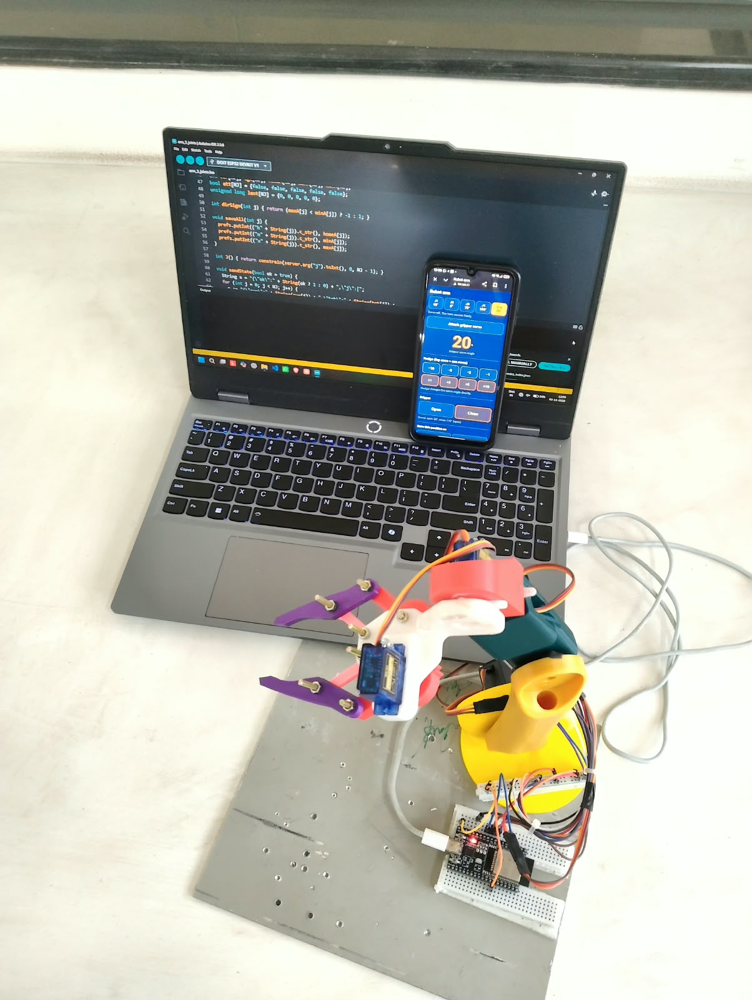

# Robotic Arm: 4-DOF Arm with Gripper, Controlled from a Phone over WiFi

A low-cost desktop robotic arm with **four degrees of freedom and a gripper**, driven by five hobby servos and an **ESP32**. The ESP32 creates its own WiFi network and serves a control web page, so any phone can move the arm from its browser. There is no app to install and no internet is needed.

Mini project for the **Basic Robotics Workshop**.

<p align="center">
  
</p>

---

## Table of contents

1. [Features](#features)
2. [How it works](#how-it-works)
3. [Hardware](#hardware)
4. [Wiring](#wiring)
5. [Power system](#power-system)
6. [Software setup](#software-setup)
7. [Using the control page](#using-the-control-page)
8. [Calibrating a joint](#calibrating-a-joint)
9. [Default values and project status](#default-values-and-project-status)
10. [HTTP endpoints](#http-endpoints)
11. [Troubleshooting](#troubleshooting)
12. [Safety](#safety)
13. [Known limitations](#known-limitations)
14. [Future work](#future-work)
15. [Repository structure](#repository-structure)
16. [Team](#team)

---

## Features

- **Four joints plus a gripper**: shoulder, elbow, wrist, wrist rotate and gripper.
- **Phone control over WiFi**: the ESP32 hosts its own network (`RobotArm`) and web page.
- **Safe start-up**: no servo is attached when the board boots, so nothing moves until you press **Attach** for that joint.
- **Tap-to-nudge control**: buttons of -10, -5, -2, -1, +1, +2, +5 and +10 degrees. One tap makes exactly one move, which is more precise than dragging a slider.
- **Smooth motion**: every joint moves one degree at a time, with a slower speed for the heavy lower joints.
- **Per-joint calibration**: save a minimum, home and maximum position for every joint. Values are stored in the ESP32 flash and survive power-off.
- **Zero-offset angles**: any raw servo angle can be set as the joint's 0 degrees, and counting can run in either direction.
- **Gripper control**: saved Open and Close angles with two big buttons.
- **No internet required**: the page is stored inside the firmware.

## How it works

```
 Phone browser ──WiFi──> ESP32 (access point + web server) ──PWM──> 5 servos
                               ^
 3S Li-ion -> BMS -> fuse -> switch -> buck (5 V) ──power──> servos + ESP32
```

1. The ESP32 starts a WiFi access point named **RobotArm** and a small web server.
2. The phone joins that network and opens `http://192.168.4.1`.
3. Each button tap sends a small HTTP request. The ESP32 changes the target angle of the selected joint.
4. In the main loop, each attached servo moves one degree at a time toward its target.
5. Calibration values are kept in flash using the `Preferences` library.

The control page is served by the ESP32 itself. A page hosted on a normal HTTPS website cannot call a plain HTTP device on the local network, because browsers block this ("mixed content"), so the page lives in the firmware.

## Hardware

| Part | Qty | Purpose |
|---|---|---|
| ESP32 development board | 1 | Controller, WiFi access point, web server |
| MG995 servo | 2 | Shoulder and elbow (high torque) |
| SG90 micro servo | 2 | Wrist and wrist rotate |
| MG90S micro servo (metal gears) | 1 | Gripper |
| 3S Li-ion battery pack | 1 | Power source (about 9 to 12.6 V) |
| 3S BMS (protection board) | 1 | Over-charge, over-discharge and short-circuit protection |
| Buck converter, 5 V, **5 A or higher** | 1 | Steps battery voltage down to 5 V |
| Fuse (about 5 A) and switch | 1 each | Over-current protection and power cut-off |
| Capacitor, about 1000 uF | 1 | Smooths servo current spikes (recommended) |
| Breadboard and jumper wires | - | ESP32 and signal connections |
| Terminal block or Wago connectors | - | Servo power distribution (recommended) |
| 3D-printed links, base and gripper | set | Structure, designed in SolidWorks |

### Joints

| Joint | Function | Motor | ESP32 pin |
|---|---|---|---|
| J1 | Shoulder | MG995 | GPIO 13 |
| J2 | Elbow | MG995 | GPIO 14 |
| J3 | Wrist | SG90 | GPIO 27 |
| J4 | Wrist rotate | SG90 | GPIO 26 |
| Gripper | Open / close | MG90S | GPIO 25 |

The arm has **no base rotation**, so it moves in one vertical plane (up, down, forward, back) and cannot swing sideways.

## Wiring

Every servo has three wires:

| Servo wire | Colour | Connect to |
|---|---|---|
| Power | Red | Buck 5 V output |
| Ground | Brown or black | Buck ground (also joined to ESP32 GND) |
| Signal | Orange or yellow | ESP32 GPIO from the table above |

Power chain:

```
Battery (3S) -> BMS -> switch -> fuse -> buck converter IN
Buck OUT 5 V -> servo red wires + ESP32 VIN
Buck OUT GND -> servo brown wires + ESP32 GND   (all grounds joined)
```

## Power system

- **Set the buck converter to 5.0 to 5.5 V with a multimeter before connecting anything else.** Many modules come set to a random voltage.
- An MG995 can draw **1 A or more** under load, and much more if it stalls. Use a buck rated **5 A or higher**, or two bucks (one for the servos, one for the ESP32).
- **Do not run heavy servo current through breadboard rails.** Breadboard contacts are only good for about 1 A. Use a terminal block or soldered joints for the servo power, and keep the breadboard for the ESP32 and the signal wires.
- A **1000 uF capacitor** across the servo supply helps if the ESP32 resets or the WiFi drops when a joint moves.
- Never power servos from the ESP32's 3.3 V or 5 V pin.
- Programme the board over USB with the **battery disconnected**. Do not feed 5 V from USB and from the buck at the same time.
- Always use a BMS and a fuse with the Li-ion pack, and charge it only with a proper 3S charger.

## Software setup

### Requirements

- [Arduino IDE](https://www.arduino.cc/en/software)
- ESP32 board support (Boards Manager: **esp32 by Espressif Systems**)
- Library **ESP32Servo** (Library Manager)
- `WiFi`, `WebServer` and `Preferences` come with the ESP32 core

### Upload

1. Open `firmware/arm_5_joints/arm_5_joints.ino`. The folder name must match the file name.
2. Select your board (usually **ESP32 Dev Module**) and the correct COM port.
3. With **only USB connected** (battery and buck disconnected), click **Upload**. If it stays on "Connecting...", hold the **BOOT** button until uploading starts.
4. Unplug USB, connect the battery side, and switch on.

### Connect

1. On your phone, join the WiFi **RobotArm** (password `12345678`).
2. Open **`http://192.168.4.1`** in the browser (type the full `http://`).
3. If the phone says "no internet", choose to stay connected.

> The WiFi name and password are set in the firmware (`WiFi.softAP("RobotArm", "12345678")`). Change the password if you share the arm in a public place.

## Using the control page

- **Tabs (J1, J2, J3, J4, Grip)**: choose a joint. Every tab shows its live angle, so all joints stay visible.
- **Attach servo**: turns that joint on. The servo goes to its saved home position (for the gripper, the saved open position). Tap again to release the servo, so the horn can be moved by hand.
- **Nudge buttons**: move the selected joint by that many degrees. `+` goes toward the saved max, `-` toward the saved min (0 degrees).
- **Save this position as Min / Home / Max**: stores the current position.
- **Go min / Go home / Go max**: moves to a saved position.
- **Type the values**: enter *Zero at*, *Home at* and *Max at* as software angles (0 to 180) and press **Apply values**.
- **Gripper tab**: **Open** and **Close** buttons, plus *Open angle* and *Close angle* save buttons.
- **Reset this joint**: restores the default values from the code.

## Calibrating a joint

Always calibrate **one joint at a time**, with only that servo wired.

1. Wire only the joint you are testing. Hold the arm near its home position by hand.
2. Open the page, select the joint tab, and press **Attach**.
3. Use small nudges (+1, +2, +5) to find the lowest safe position. Tap **Min (0 degrees)**.
4. Move to the position where the arm should rest (for example standing vertical). Tap **Home**.
5. Move to the highest safe position. Tap **Max**.
6. Check with **Go min**, **Go home** and **Go max**.

The joint angle shown on the page is:

```
joint_angle = s x (raw_angle - raw_min)
s = +1 if raw_max >= raw_min, otherwise s = -1
```

This means the saved Min is always 0 degrees, even when the Min is the *larger* raw number. The raw servo angle is always shown below the big number.

**Why this exists:** a servo turns only about 180 degrees, and the horn can be fitted only at fixed spline steps, so the arm's useful range rarely lines up with the servo's 0 to 180. On the shoulder joint of this build, the arm stands vertical at a raw angle of 150, leaving only 30 degrees of travel on one side. Software cannot add travel beyond the servo's end. If you need more range, remove the horn and refit it a few splines over.

## Default values and project status

Defaults in the firmware (raw servo angles, 0 to 180):

| Joint | Min (= 0 degrees) | Home | Max | Status |
|---|---|---|---|---|
| J1 Shoulder | 180 | 150 | 90 | Calibrated (shows 0, 30, 90 degrees) |
| J2 Elbow | 0 | 90 | 180 | Placeholder values |
| J3 Wrist | 0 | 90 | 180 | Placeholder values |
| J4 Wrist rotate | 0 | 90 | 180 | Placeholder values |
| Gripper | Close 40 | - | Open 110 | Placeholder values |

Only joint 1 has final calibration values. For the others, set the real values on the page (Save buttons or typed values). **Do not use Go min or Go max on an uncalibrated joint**, because the placeholder limits could push the arm into something.

## HTTP endpoints

The page uses these endpoints on the ESP32 (the parameter `j` is the joint index, 0 to 4):

| Endpoint | Purpose |
|---|---|
| `/` | Control page |
| `/state` | JSON with the angles and saved values of all joints |
| `/att?on=1\|0&j=` | Attach or release a joint's servo |
| `/nudge?d=&j=` | Move a joint by `d` degrees |
| `/go?w=min\|home\|max&j=` | Move to a saved position |
| `/grip?open=1\|0&j=4` | Open or close the gripper |
| `/save?w=min\|home\|max\|open\|close&j=` | Save the current position |
| `/setrange?min=&home=&max=&j=` | Apply typed values |
| `/reset?j=` | Restore the code defaults for a joint |

## Troubleshooting

| Problem | Likely cause and fix |
|---|---|
| Upload fails: "could not open COM port" | Use a **data** USB cable (many are charge-only), install the CP2102 or CH340 driver, pick the right port, close the Serial Monitor, hold BOOT while uploading. |
| `RobotArm` WiFi not visible | Press the EN (reset) button, wait about 5 seconds, refresh the WiFi list. Check the Serial Monitor (115200 baud) for the printed address. |
| Page does not load | Type the full `http://192.168.4.1`. Turn off mobile data if the phone keeps switching away from the no-internet network. |
| Servos move randomly when powered | Make sure you use this firmware (servos stay detached at boot), and that the ESP32 and servo grounds are joined. |
| ESP32 resets or WiFi drops when a joint moves | Power problem. Add a 1000 uF capacitor, use a 5 A or larger buck, take servo power off the breadboard, check the battery charge. |
| ESP32 gets hot | A slightly warm board is normal with WiFi on. If too hot to touch, check for shorts and for servo power taken from the board's 3.3 V or 5 V pin. |
| +1 nudge does nothing | A 1 degree step can be inside the servo's dead-band and backlash under load. Use +2 or larger. |
| Elbow drops under the arm's weight | Not enough torque or supply current at that angle. Use slower steps, add a spring or counter-weight, and check power. |
| Servo buzzes at an end position | The joint is pushing against a stop. Save the limit a few degrees earlier. |

## Safety

- Keep the servos **off** (not attached) while wiring, and hold the arm when you attach a joint, because it jumps to its home position.
- Start with small nudges and keep a hand on the power switch for the first movements.
- Do not force a joint by hand while it is attached.
- Use the BMS, fuse and switch on the Li-ion pack. Never leave a battery charging unattended.
- Keep fingers clear of the gripper and the gear mechanism.

## Known limitations

- No base rotation, so motion is limited to one vertical plane.
- Hobby servos give no position feedback, so the real position under load is not known.
- The elbow can struggle to hold the forearm against gravity at some angles.
- Heavy objects are not supported. Aim for light items such as small blocks or foam pieces.
- The control is manual. Pick positions are set by the user, there is no vision.
- Joints J2, J3, J4 and the gripper still need their final calibration.

## Future work

- Base rotation with a turntable bearing (a fifth motor).
- Record and replay of pick-and-place sequences.
- Counter-weight or spring balance for the shoulder and elbow.
- A PCA9685 servo driver and a proper power distribution board instead of a breadboard.
- Limit switches or current sensing to detect stalled joints.
- Camera-based object detection for automatic picking.


.

## Team

Mini project team, Basic Robotics Workshop:

| Name |
|---|
| **Jatin Lalchandani** |
| **Varad Kannav** |
| **Tanushree** |


